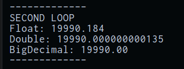
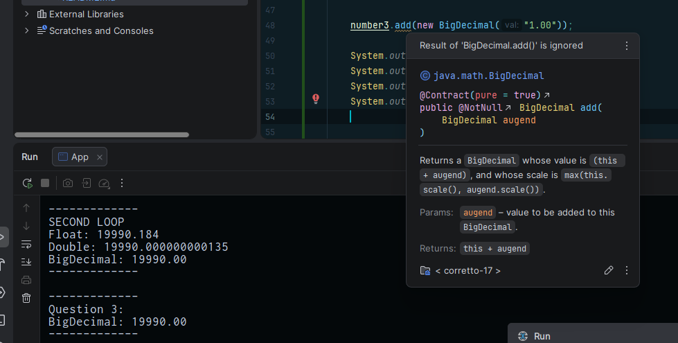

# Questions:

### 1. How many cents is float off after 1000 iterations?
18.4 cents

### 2. Why does BigDecimal print 1.00 and not 1?
BigDecimal uses a scale to determine how many places there should be after the decimal.

"the BigDecimal 3.14 has an unscaled value of 314 and a scale of 2" -
https://www.baeldung.com/java-bigdecimal-biginteger

### 3. What happens if you call .add(); without assigning the result back to your variable?
The result of the .add() is ignored.

